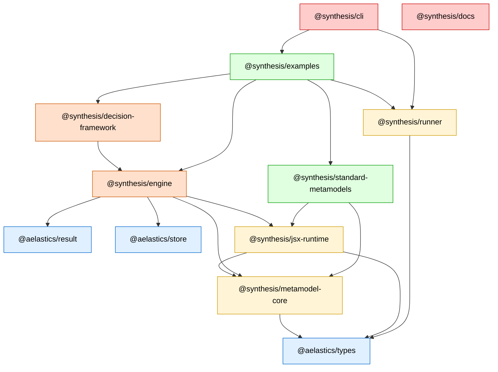

# Monorepo Architecture

Synthesis is organized as a 10-package monorepo with a strict, acyclic dependency graph. Packages are layered from generic infrastructure at the bottom to applications at the top.

## Packages by Layer

**Layer 0 — Generic infra** (no Synthesis-specific knowledge)

- `@aelastics/types`
- `@aelastics/result`
- `@aelastics/store`

**Layer 1 — Synthesis foundations** (siblings, neither depends on the other)

- `@synthesis/metamodel-core` — depends on `@aelastics/types`
- `@synthesis/jsx-runtime` — depends on `@aelastics/types`, `@synthesis/metamodel-core`

**Layer 2 — Runtime + utility packages**

- `@synthesis/engine` — depends on `@synthesis/metamodel-core`, `@synthesis/jsx-runtime`, `@aelastics/result`, `@aelastics/store`
- `@synthesis/runner` — depends on `@aelastics/types`

**Layer 3 — Decision-driven extension**

- `@synthesis/decision-framework` — depends on `@synthesis/engine`

**Layer 4 — Applications**

- `@synthesis/standard-metamodels` — depends on `@synthesis/metamodel-core`, `@synthesis/jsx-runtime`
- `@synthesis/examples` — depends on `@synthesis/engine`, `@synthesis/decision-framework`, `@synthesis/standard-metamodels`, `@synthesis/runner`
- `@synthesis/cli` — depends on `@synthesis/examples`, `@synthesis/runner`
- `@synthesis/docs` — independent (typedoc site, not in build graph)

## Dependency Graph



An arrow `A → B` means *A depends on B* — A imports from B.

## Rules

- No cycles. Arrows always go from higher layers down.
- `@synthesis/metamodel-core` exports type schemas via the default subpath AND JSX wrappers (`Element`, `Model`) via its `/jsx` subpath — both are in the same package.
- `@synthesis/standard-metamodels` does NOT depend on `@synthesis/engine` — it depends only on `metamodel-core` and `jsx-runtime`.
- `@synthesis/jsx-runtime` is a foundational sibling of `metamodel-core`, NOT downstream of engine. This is what breaks what would otherwise be a cycle.

## Layer 0 — Generic infra

Three `@aelastics/*` packages with no Synthesis-specific knowledge. `@aelastics/result` provides a `Result` monad for error-typed returns. `@aelastics/types` is a runtime type schema framework. `@aelastics/store` is an observable store. Any future product under the Aelastics organization could reuse them as-is.

## Layer 1 — Synthesis foundations

Two sibling packages with no mutual dependency. `@synthesis/metamodel-core` defines the M3-level type schemas (`Model`, `ModelElement`, `Namespace`, `Diagram`, `RepositoryObject`, plus basic types like `IDType`, `NameType`, `DescriptionType`). `@synthesis/jsx-runtime` provides JSX authoring primitives (`ExprNode`, `Template`, `Context`, the `IM2MContext` and `IStore` interfaces, URL/path parsing).

Keeping the JSX runtime here — not bundled inside the engine — is what lets `metamodel-core` define its own JSX wrappers (`Element`, `Model`) for its foundational types, co-located with their type definitions, without creating a cycle.

## Layer 2 — Runtime + utility packages

`@synthesis/engine` is the M2M transformation runtime: the `abstractM2M` base class, decorators (`@E2E`, `@SpecPoint`, `@SpecOption`), the pure trace metamodel, `ModelStore`, `M2MContext` (which implements `IM2MContext` from `jsx-runtime`), the `m2t` text-generation tool, and the `jsx-export` snapshot tool. The engine is decision-agnostic — it knows nothing about decisions, configurations, or variability.

`@synthesis/runner` defines the minimal execution contract (`Runnable` + `RunnableRegistry`) that consumers of the engine implement. It has no engine dependency, so it can be reused outside the engine context.

## Layer 3 — Decision-driven extension

`@synthesis/decision-framework` is the optional decision-aware layer built on top of the engine: decision / binding / configuration / trace-extension metamodels, the `DecisionAwareM2M` subclass of `abstractM2M`, and the variability decorators (`@VarPoint`, `@VarOption`, `@Default`).

## Layer 4 — Applications

Four user-facing packages. `@synthesis/standard-metamodels` ships canonical domain metamodels (EER, Relational, BPM, types-metamodel); it depends only on `metamodel-core` + `jsx-runtime`, never on the engine, which keeps it usable in arbitrary contexts. `@synthesis/examples` provides demonstrations as `Runnable` instances. `@synthesis/cli` is the user entry point — it discovers and runs examples via the Runner contract. `@synthesis/docs` is the Docusaurus documentation site, independent of the build graph.

## Subpaths on `@synthesis/metamodel-core`

`@synthesis/metamodel-core` is a single package that exposes two subpaths:

- `.` — the type schemas (`Model`, `ModelElement`, `Namespace`, etc.) as `@aelastics/types` schemas
- `/jsx` — matching JSX wrapper components (`Element`, `Model`, etc.) for authoring instances

```ts
import { Model, ModelElement } from '@synthesis/metamodel-core';
import { Element } from '@synthesis/metamodel-core/jsx';
```

The two subpaths live in one package so the schemas and their JSX wrappers stay co-located, with no cross-package coupling.

## Why this structure?

A layered, acyclic dependency graph keeps each package's responsibility narrow and its API surface explicit. Lower layers ship without knowing about higher ones, so they can be reused, versioned, and tested in isolation. Optional capabilities (decisions, variability) live in separate layers that consumers opt into by adding a dependency. Forbidding cycles means there is always a clear bottom-up build order and no hidden coupling between siblings.
