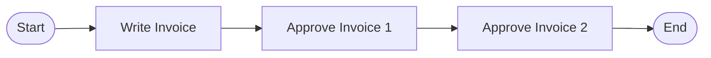
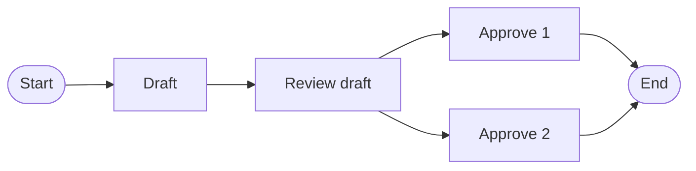

# Concepts

One idea underlies everything in Synthesis: **a model is a value: the
result of evaluating an expression.** What you write in JSX is not the
model; it is a *term* in a **model expression algebra**. Rendering the
expression is the evaluation that produces the model. Every other concept
in this guide (components, templates, transformation rules) is a
disciplined way of writing such terms.

This page builds that idea up from one small example.

## A model is the value of an expression

A simple approval workflow, one Write task followed by two parallel
Approve tasks, written as a model expression (imports and the JSX
pragma elided; setup is covered in [Building Model Instances](./guides/building-models.md)):

```tsx
const approval = (
  <WorkflowModel name="Approval">
    <Process name="Approval">
      <Task name="Write" />
      <Parallel>
        <Task name="Approve 1" />
        <Task name="Approve 2" />
      </Parallel>
    </Process>
  </WorkflowModel>
)
```

The JSX expression is a tree of unevaluated element descriptions.
Rendering evaluates it: each tag creates a typed model element, nesting
becomes association, and the result is the model: an approval
process in which *Write* is followed by two parallel approvals. (How
rendering is invoked, including the model store every element is
created in, is machinery, covered in
[Building Model Instances](./guides/building-models.md).)


Expression and value are different things, and keeping them apart is what
gives Synthesis its power: expressions can be abstracted over, passed
around, and composed *before* they are ever evaluated.

## The four operators

Every model expression is composed from exactly four kinds of operators:

| Operator | In JSX | What evaluation does |
|---|---|---|
| **Model creation** | the root model tag: `<WorkflowModel …>` | creates a **model**: a typed container with its own namespace and type schema, into which child elements are placed |
| **Element creation** | element tags: `<Task>`, `<Process>`, `<Document>` | creates a typed **element** with its properties and connects it to its parent |
| **Reference** | `$refByName`, `$ref`, `$refByID` | **retrieves** an existing element instead of creating one |
| **Computation** | TypeScript in `{ … }`: `map`, conditionals, function calls | **computes** sub-expressions dynamically |

The tags are not built in: each metamodel contributes its own (an EER
metamodel brings `<EERSchema>`, `<Entity>`, `<Attribute>`), and the
four operators are the same in every domain.

The first two build structure. The third is what makes models true
*graphs* rather than trees: nesting alone can only express containment,
while a reference connects an element to something created elsewhere.
Here the workflow from the top of the page gains a document: `Report`
is declared once, at model level, and every task that works with the
report references it:

```tsx
<WorkflowModel name="Approval">
  <Document name="Report" />
  <Process name="Approval">
    <Task name="Write" outputs={[<Document $refByName="Report" />]} />
    <Parallel>
      <Task name="Approve 1" inputs={[<Document $refByName="Report" />]} />
      <Task name="Approve 2" inputs={[<Document $refByName="Report" />]} />
    </Parallel>
  </Process>
</WorkflowModel>
```

`<Document $refByName="Report" />` creates no new document: it looks
up the one declared element and connects it, so all three interfaces
point at the same node, three edges into one element. A reference must
resolve to an element that exists when it is evaluated; an
unresolvable name is a construction error, not a silent null. When the metamodel declares name scopes,
resolution is scope-aware: a bare name is probed from the nearest
enclosing scope outward, and a path such as `ManagerSignoff/Sign`
reaches into a sibling scope. See
[References](./guides/building-models.md#references) for the three
reference forms and
[Name scopes](./guides/building-models.md#name-scopes) for scoped
resolution.

The fourth operator is where the host language comes in. Anything
TypeScript can compute can appear inside `{ … }`, as long as it produces
model expressions of the type expected at that position. This single
mechanism replaces the special-purpose loop/conditional constructs of
conventional transformation languages, and it is what makes
parameterization possible.

## Templates define families of models

Add parameters to an expression and it stops describing one model and
starts describing a **family** of models. A parameterized model
expression is a **model template**: a function returning a model
expression, in algebraic terms an open term with free variables. Seen
this way, what we ordinarily call "a model" written in JSX is just the
boundary case: an expression with no parameters and no computation is a
**model literal**, and always evaluates to the same model. The approval
process at the top of this page is a model literal; here is the same
workflow as a template:

```tsx
type ApprovalProps = { doc: string; approvers: number; parallel: boolean }

const Approval = ({ doc, approvers, parallel }: ApprovalProps) => {
  const tasks = Array.from({ length: approvers }, (_, i) =>
    <Task name={`Approve ${doc} ${i + 1}`} />)

  return (
    <WorkflowModel name={`${doc} Approval`}>
      <Process name={`${doc} Approval`}>
        <Task name={`Write ${doc}`} />
        {parallel ? <Parallel>{tasks}</Parallel>
                  : <Sequence>{tasks}</Sequence>}
      </Process>
    </WorkflowModel>
  )
}
```

Two instantiations, two structurally different models from the same
definition: different element counts, different topology, different
property values.

`<Approval doc="Contract" approvers={3} parallel={true} />` produces a
model whose process has three parallel approvals:


`<Approval doc="Invoice" approvers={2} parallel={false} />` produces a
model whose process has two sequential approvals:



### Higher-order templates

Because templates are ordinary functions, they compose like functions,
and nothing stops a parameter from itself being a template. A
**higher-order template** takes another template as a parameter and
abstracts over the *structure* of its sub-expressions, not just their
property values. The reusable unit also shifts: a template's result
need not be a whole model, and the templates below deliberately return
steps and processes, sub-expressions to be embedded under a model root
at the end.

First define the writing step as a template of its own, outside any
workflow:

```tsx
const Write = () => <Task name="Write" />

const ReviewedWrite = () => (
  <Process name="WriteDocument">
    <Task name="Draft" />
    <Task name="ReviewDraft" />
  </Process>
)
```

Then define the workflow as a higher-order template whose parameter is
the whole step template (both definitions above qualify as
`Template<IStep>`, the common step supertype: a plain task and an
inline process alike):

```tsx
type ApprovalProps = { doc: string; approvers: number }

const Approval = (WriteStep: Template<IStep>) =>
  ({ doc, approvers }: ApprovalProps) => (
    <Process name={`${doc} Approval`}>
      <WriteStep />
      <Parallel>
        {Array.from({ length: approvers }, (_, i) => <Task name={`Approve ${i + 1}`} />)}
      </Parallel>
    </Process>
  )
```

Evaluation now happens in **two steps**. Applying the higher-order
template to a step template yields an ordinary template; supplying the
remaining parameters closes the expression, and embedding it under a
model root completes the model expression, which rendering evaluates
to the model:

```tsx
const SimpleApproval = Approval(Write)                            // a template
const contract = <SimpleApproval doc="Contract" approvers={2} />  // a closed expression
const contracts = (
  <WorkflowModel name="Contracts">{contract}</WorkflowModel>
)                                                                 // the model expression
```

Swapping the step swaps structure, not just values:
`Approval(ReviewedWrite)` produces workflows whose writing step is a
two-task inline process, without touching the workflow skeleton:



A value parameter (like `parallel` above) selects among shapes the
template already contains; a template parameter *supplies* the shape.
(A fixed step can also be passed as a ready-made expression value,
`const write = <Task … />`, and embedded with `{write}`; the template
form shown here is the general one, constructing the step fresh at
every use and admitting parameters of its own.) This exact
construction ships executable in the workflow example suite; the
[Templates guide](./guides/templates.md#higher-order-templates) embeds
it and shows how to run it.

## Transformations are templates over a source model

A model-to-model transformation is the last rung of the page's ladder
of parameters: a value parameter selects among shapes, a template
parameter supplies a shape, and here the parameter is a whole
**source model**, from which another model is derived.

A transformation is an ordinary TypeScript class extending the
library's abstract transformation class. The base class carries the
engine: rule dispatch, trace recording, target resolution. The
subclass declares the *rules*: its `template` method is the top-level
rule, receiving the source model and iterating over its elements with
the computation operator, and every further rule is a typed method
from one source element to a target expression, written with the
target metamodel's tags. Because a rule body is plain TypeScript, the
whole language is available inside it: types, generics, helper
functions and methods, closures. Here is the shape, the workflow
suite's own derivation of an approval workflow from an organizational
model:

```tsx
export class OrgToApproval extends abstractM2M<ot.IOrganization, wt.IWorkflowModel> {
  template(m: ot.IOrganization) {
    return (
      <WorkflowModel name={`${m.name} Approval`} store={this.context.store}>
        <Process name={`${m.name} Approval`}>
          <Task name="WriteDocument" />
          {m.elements
            .filter((el) => this.context.store.isTypeOf(el, ot.OrgUnit))
            .map((el) => this.OrgUnit2Approval(el as ot.IOrgUnit))}
        </Process>
      </WorkflowModel>
    )
  }

  @E2E()
  @SpecPoint()
  OrgUnit2Approval(u: ot.IOrgUnit): ExprNode<wt.IStep> {
    return undefined! // pure dispatcher: the matching option supplies the result
  }

  // A department's approval is one task, its manager's.
  @SpecOption('OrgUnit2Approval', ot.Department)
  Department2Approval(d: ot.IDepartment): ExprNode<wt.ITask> {
    return <Task name={`ApproveBy${d.manager.name}`} performer={d.manager.name} />
  }
}
```

The source side is an organizational metamodel, a hierarchy of units
with managers and members; the target side is the workflow language
this whole page has been using, so the approval process the page
opened with is not just authorable, it is derivable. The `template`
maps every unit of the source model through `OrgUnit2Approval`, and
that rule is a *specialization point*: rules marked as its options
dispatch on the source element's runtime type, a department
contributing its manager's approval task, a board (its option is not
shown) a parallel block of member approvals. This is the mechanism
behind [Polymorphic Rule Dispatch](./guides/polymorphic-dispatch.md).

Executing the transformation evaluates `template`'s expression in a
fresh target model; every rule invocation is recorded in a **trace**
linking each target element back to the source elements it came from,
giving bidirectional traceability for free.

The workflow suite ships the full version of this transformation as
its generative example: it additionally takes a run parameter, whose
document needs approval and how many levels of the hierarchy approve
it, and derives the chain for one worker, with the error guards the
page omits. The
[model-to-model tutorial](./tutorial/model-to-model/part-1-basic/index.md)
builds a complete transformation start to finish, in the EER domain;
the full authoring workflow is in
[Writing Transformations](./guides/writing-transformations.md).

### Model to model, and model to text

A transformation's target can be another model or it can be text, and
Synthesis treats those as the same kind of thing.

A **model-to-model** transformation (`m2m`) produces a model of the
target metamodel: an organizational model becomes an approval
workflow, whose elements are ordinary model elements you can query,
transform again, or store in the workspace.

A **model-to-text** transformation (`m2t`) produces text, and it does
so by targeting the engine's text-document metamodel, whose concepts
are documents, sections, and paragraphs. Drawing a workflow as a
Mermaid flowchart means building a document expression whose
paragraphs happen to contain Mermaid text. Nothing about the rules
changes: they are the same typed functions returning JSX over a
target metamodel's components.

The difference is what happens to the result. An m2m result is written
back into the workspace as a model, with a provenance header recording
what produced it. An m2t result is serialized to files in a directory.
A transformation package declares which kind it is in its manifest, and
the two compose: a chain may pass models from step to step and end with
a text step, because text is terminal. The
[model-to-text tutorial](./tutorial/model-to-text/index.md) builds a
generator this way, consuming exactly what the model-to-model tutorial
produces.

### Configuration-based transformations

Some transformations contain genuinely open design choices: whether a
1:N relationship becomes a foreign key or a join table, how identifiers
are quoted, how generated output is laid out across files. Synthesis
makes such a choice a first-class model rather than a hidden flag. A
**decision model** declares the design space: its *issues* and the
*options* each issue offers, globally or per source element. A
**configuration model** records the choices made for one specific
source model. A **configuration-based transformation** is then a
template over two parameters, the source model and a configuration
model: a rule with variants is written as a *variation point*, and the
recorded choice selects which variant runs.

Because configurations are models, everything already said about models
applies: they are validated (against the decision model, its binding to
metamodel concepts, and the input model), default configurations can be
generated from the decision model's declared defaults, and every choice
applied during a run is announced. The mechanism, decorators included,
is in the
[Design Decisions in Transformations](./guides/variability.md) guide;
the tutorials each build one configuration-based rule, for
[model-to-model](./tutorial/model-to-model/part-3-configuration-based/index.md)
and
[model-to-text](./tutorial/model-to-text/part-3-configuration-based/index.md)
transformations.

## Metamodels are type schemas

A metamodel in Synthesis is a **type schema**: a set of runtime types
(defined with [`@aelastics/types`](../types/intro.md)) that constrains the
algebra. It determines which tags exist, which properties they take,
which children may appear where, and which subtype hierarchies rules can
dispatch over.
Conformance is not an afterthought checked by a separate validator: a
well-typed expression evaluates to a model that conforms to its schema.
TypeScript checks what it can statically, and the model store enforces
type conformance on every connection at runtime. The authoring workflow
is in [Defining Metamodels](./guides/defining-metamodels.md), and the
components that give a metamodel its JSX tags are covered in
[JSX Components](./guides/jsx-components.md).

Two guarantees are worth knowing by name:

- **Type preservation**: evaluating a well-typed model expression yields
  a model conforming to its type schema.
- **Type-safe execution**: if the source model conforms to the source
  schema and every rule produces well-typed target expressions, the
  transformation result conforms to the target schema.

Together they mean conformance is preserved *compositionally*: you get a
valid target model because every step preserves validity, not because a
final check happened to pass.

## Models all the way down

A model is itself a model element. Two useful consequences follow, with
no extra machinery:

- Models can contain other models: a model of models (a *megamodel*),
  used to organize collections of interrelated models.
- An element's property can store a qualified name that designates an
  element in *another* model, like a foreign key. Models built from such
  references (*weaving models*) capture typed correspondences between
  independent models; transformation traces and cross-model links are
  built on this.

## Formal background

The algebra sketched here is developed rigorously, with full definitions,
the type constructor system, conformance, evaluation semantics, and
proofs of the properties named above, in the companion paper:

> S. Nešković and D. Stojimirović, *Models as Values in a Model
> Expression Algebra: A Functional Approach to Model Driven Engineering*.

The paper is the formal foundation of the approach; this documentation
describes the current implementation, which has continued to evolve since
the paper was written. Where tooling details differ, the documentation is
authoritative for practical use.
