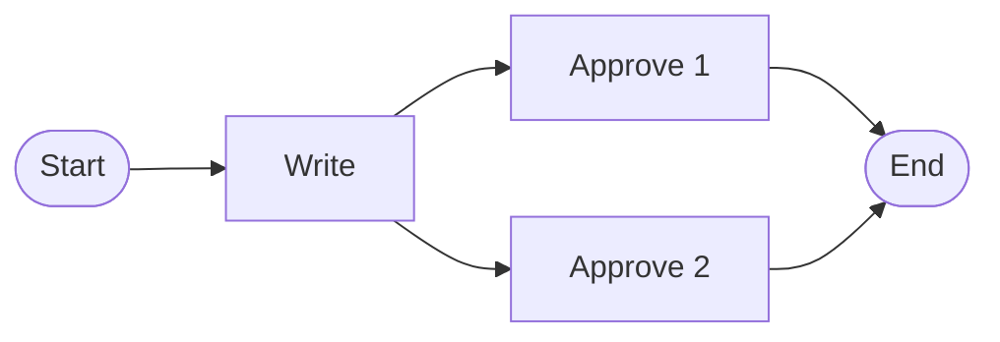
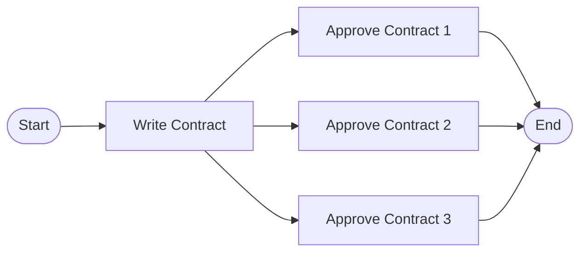

# Concepts

One idea underlies everything in Synthesis: **a model is a value: the
result of evaluating an expression.** What you write in JSX is not the
model; it is a *term* in a **model expression algebra**. Rendering the
expression is the evaluation that produces the model. Every other concept
in this guide (components, templates, transformation rules) is a
disciplined way of writing such terms.

This page builds that idea up from one small example.

## A model is the value of an expression

A simple approval workflow, one Write task followed by two parallel
Approve tasks, written as a model expression (imports and the JSX
pragma elided; setup is covered in [Building Model Instances](./guides/building-models.md)):

```tsx
const approval = (
  <Process name="Approval" store={store}>
    <Sequence>
      <Task name="Write" />
      <Parallel>
        <Task name="Approve 1" />
        <Task name="Approve 2" />
      </Parallel>
    </Sequence>
  </Process>
)

const model = approval.render(new Context())
```

The JSX expression is a tree of unevaluated element descriptions.
`render()` evaluates it: each tag creates a typed model element, nesting
becomes association, and the result is the model: an approval
process in which *Write* is followed by two parallel approvals:



Expression and value are different things, and keeping them apart is what
gives Synthesis its power: expressions can be abstracted over, passed
around, and composed *before* they are ever evaluated.

## The four operators

Every model expression is composed from exactly four kinds of operators:

| Operator | In JSX | What evaluation does |
|---|---|---|
| **Model creation** | the root model tag: `<Process store={store}>`, `<EERSchema …>` | creates a **model**: a typed container with its own namespace and type schema, into which child elements are placed |
| **Element creation** | element tags: `<Task>`, `<Kernel>`, `<Column>` | creates a typed **element** with its properties and connects it to its parent |
| **Reference** | `$refByName`, `$ref`, `$refByID` | **retrieves** an existing element instead of creating one |
| **Computation** | TypeScript in `{ … }`: `map`, conditionals, function calls | **computes** sub-expressions dynamically |

The first two build structure. The third is what makes models true
*graphs* rather than trees: nesting alone can only express containment,
while a reference connects an element to something created elsewhere:

```tsx
<Attribute name="PersonName">
  <Domain $refByName="string" />
</Attribute>
```

Here no new `Domain` is created; the existing element named `string` is
looked up and connected. A reference must resolve to an element that
exists when it is evaluated; an unresolvable name is a construction
error, not a silent null. See
[References](./guides/building-models.md#references) for the three
reference forms.

The fourth operator is where the host language comes in. Anything
TypeScript can compute can appear inside `{ … }`, as long as it produces
model expressions of the type expected at that position. This single
mechanism replaces the special-purpose loop/conditional constructs of
conventional transformation languages, and it is what makes
parameterization possible.

## Templates define families of models

Add parameters to an expression and it stops describing one model and
starts describing a **family** of models. A *template* is a function
returning a model expression, in algebraic terms an open term with free
variables:

```tsx
const Approval = ({ doc, approvers, parallel }: IApprovalConfig) => {
  const tasks = Array.from({ length: approvers }, (_, i) =>
    <Task name={`Approve ${doc} ${i + 1}`} />)

  return (
    <Process name={`${doc} Approval`}>
      <Sequence>
        <Task name={`Write ${doc}`} />
        {parallel ? <Parallel>{tasks}</Parallel>
                  : <Sequence>{tasks}</Sequence>}
      </Sequence>
    </Process>
  )
}
```

Two instantiations, two structurally different models from the same
definition: different element counts, different topology, different
property values.

`<Approval doc="Contract" approvers={3} parallel={true} />` produces a
process with three parallel approvals:



`<Approval doc="Invoice" approvers={2} parallel={false} />` produces a
process with two sequential approvals:


An expression with no parameters and no computation is a *model literal*:
it always evaluates to the same model. And because templates are ordinary
functions, they compose like functions: a **higher-order template** takes
another template as a parameter and abstracts over the structure of its
sub-expressions; see
[Higher-Order Templates](./guides/building-models.md#higher-order-templates)
for a worked example.

## Transformations are templates over a source model

A model-to-model transformation is a template whose parameter is a
**source model**. It is written as a class of typed *rules*: each rule is
a function from a source element to a target model expression:

```tsx
@E2E()
Entity2Table(e: et.IEntity): ExprNode<rt.ITable> {
  return (
    <r.Table name={e.name}>
      {e.attributes.map((a) => this.Attribute2Column(a))}
    </r.Table>
  )
}
```

Each rule is a template like any other, with the computation operator iterating over
the source element's properties and invoking further rules. Executing the
transformation evaluates the top-level rule's expression in a fresh
target model; every rule invocation is recorded in a **trace** linking
each target element back to the source elements it came from, giving
bidirectional traceability for free.

Rule selection is *subtype-aware*: when several rules could apply to a
source element, the most specific one for the element's runtime type is
dispatched. This is the mechanism behind
[Polymorphic Rule Dispatch](./guides/polymorphic-dispatch.md). The full
authoring workflow is in
[Writing Transformations](./guides/writing-transformations.md).

## Metamodels are type schemas

A metamodel in Synthesis is a **type schema**: a set of runtime types
(defined with [`@aelastics/types`](../types/intro.md)) that constrains the
algebra. It determines which tags exist, which properties they take,
which children may appear where, and which subtype hierarchies rules can
dispatch over.
Conformance is not an afterthought checked by a separate validator: a
well-typed expression evaluates to a model that conforms to its schema.
TypeScript checks what it can statically, and the model store enforces
type conformance on every connection at runtime.

Two guarantees are worth knowing by name:

- **Type preservation**: evaluating a well-typed model expression yields
  a model conforming to its type schema.
- **Type-safe execution**: if the source model conforms to the source
  schema and every rule produces well-typed target expressions, the
  transformation result conforms to the target schema.

Together they mean conformance is preserved *compositionally*: you get a
valid target model because every step preserves validity, not because a
final check happened to pass.

## Models all the way down

A model is itself a model element. Two useful consequences follow, with
no extra machinery:

- Models can contain other models: a model of models (a *megamodel*),
  used to organize collections of interrelated models.
- An element's property can store a qualified name that designates an
  element in *another* model, like a foreign key. Models built from such
  references (*weaving models*) capture typed correspondences between
  independent models; transformation traces and cross-model links are
  built on this.

## Formal background

The algebra sketched here is developed rigorously, with full definitions,
the type constructor system, conformance, evaluation semantics, and
proofs of the properties named above, in the companion paper:

> S. Nešković and D. Stojimirović, *Models as Values in a Model
> Expression Algebra: A Functional Approach to Model Driven Engineering*.

The paper is the formal foundation of the approach; this documentation
describes the current implementation, which has continued to evolve since
the paper was written. Where tooling details differ, the documentation is
authoritative for practical use.
