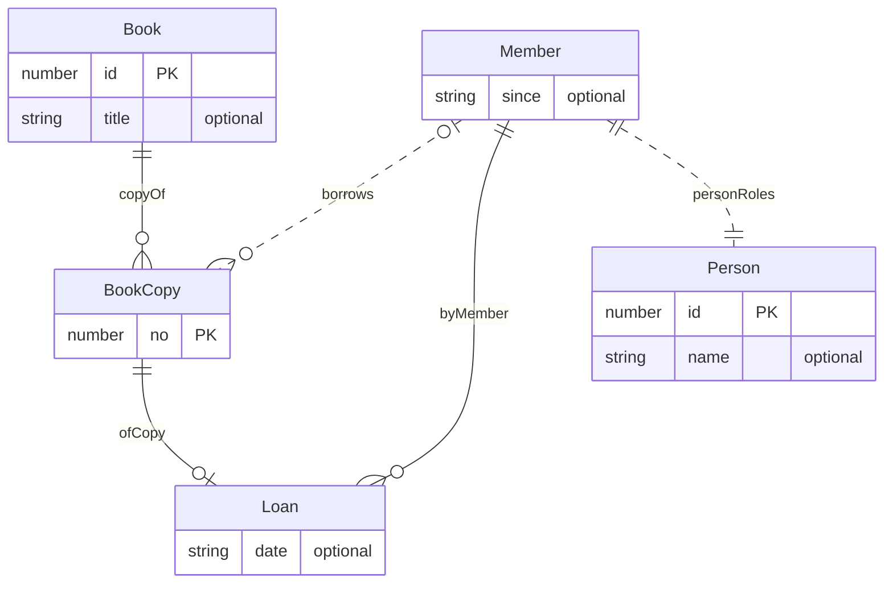

# A full-featured EER to SQL transformation

The `examples/eer-to-sql` suite turns a conceptual entity-relationship
schema into a production-shaped relational database, and draws it.
Its goals are completeness and explicitness. Completeness: every
semantic fact the EER schema states (identification, integrity rules,
domains, optionality) reaches the output as a first-class fact
instead of being lost in translation. Explicitness: every design
question with more than one defensible answer stays open as a
declared decision, closed per run by a configuration model rather
than hardcoded in the rules.

What the suite contains, and what each piece shows:

- **Two full-semantics metamodels** (`eer-metamodel`,
  `relational-metamodel`): entities in three identification kinds,
  specializations as mappings with completeness and disjointness
  bounds, integrity rule pairs, user-definable domains; tables with
  first-class keys, constraints, indexes, wired domains, and row
  history. Their doctrine is declared as constraints and enforced by
  `synth model validate`.
- **`eer-to-relational`** (model to model): the full mapping, every
  template kind, and nine design issues closed per run by a
  configuration: auditing and row history (the composite option),
  inheritance strategies, relationship mapping, naming, keys, and
  indexing.
- **`rel-to-sql-ddl`** (model to text): executable SQL, a schema
  script and a triggers script, with dialects as extension-authored
  preset configurations and physical clustering. It consumes exactly
  what `eer-to-relational` produces, so the two run as a chain.
- **`eer-to-mermaid-er`** (model to text): the
  [diagram view](#the-diagram-view-eer-to-mermaid), a Mermaid
  `erDiagram` per schema over the same EER source, a sibling view
  rather than a chain step.
- **A trace per run**, recording which decision produced which table.

This page is the canonical explanation of all of it: the metamodels,
the relational mapping rule by rule, the diagram conventions, the
dialects, and the design space with each decision's rationale. The
package READMEs stay deliberately short and point here; every rule
described below is enforced by the suite's executable verification
on every merge.

Two doctrine points shape the whole mapping. Relationships are
strictly binary: relating more than two entities (and sometimes two)
is modeled as an Aggregation, and the transformation refuses other
arities with a message that says exactly that. And a fact lives in
one place: key-ness is membership in a table's `PrimaryKey` element
(there is no `isKey` mark on columns), a column is a foreign key
exactly when a `ForeignKey` pair names it, and semantic completeness
rules are declared constraints on the metamodel, run by
`synth model validate`.

## The metamodels

The suite owns both metamodels (`eer-metamodel` and
`relational-metamodel`, under `examples/eer-to-sql/metamodels/`).
They carry full semantics, richer than the
[tutorial's](../tutorial/model-to-model/index.md) deliberately simple
ones, and this section is all you need to read the rest of the page.

### The EER side

An `EERSchema` holds domains, entities, relationships, and
specializations. Entities come in three identification kinds:

- A **Kernel** is identified by its own key attributes.
- A **Weak** entity is identified through an owner: a `WeakMapping`
  names the owner, and the weak entity's full key is the owner's key
  plus its own partial key. It is existence-dependent: no owner row,
  no weak row.
- An **Aggregation** is identified by the entities it relates: at
  least two `AggregationMapping` elements name the participants. This
  is also the doctrine's answer to n-ary or attribute-carrying
  relationships: a `Relationship` is strictly binary (two `Role`
  elements with `lowerBound`/`upperBound` cardinalities) and carries
  no attributes, and anything richer is an aggregation.

Subtyping is declared by a `Specialization`, and a specialization IS
a mapping: from the root entity's instance set into the union of its
subtypes' sets. It nests inside the entity it specializes (which may
be `isAbstract`), and one entity may carry SEVERAL specializations,
each an independent category of subtyping (a person specializes by
role; an author, separately, by engagement). Its cardinalities carry
the two classical subtyping constraints: `lowerBound` is
completeness (0 partial, 1 total: must every root instance belong to
a subtype?), `upperBound` is disjointness (1 disjoint, M
overlapping: may an instance belong to several subtypes at once, a
worker who is also a student?). A `Subtype` is a first-class entity,
authored at top level like any other; it declares its membership
with a scope-qualified `supertype` reference. An `Attribute`
carries `isKey` and `isOptional`, may be composite (one level of
nested component attributes), and takes its type from a `Domain`:
a primitive name (`number`, `string`, `date`, ...) or a user-defined
domain with `baseType`, `check`, and `defaultValue`. An entity is a
name scope, so every entity can have its own plain `id`.

Every mapping guards the association it represents with an integrity
pair: `cn`, the connect rule (the association is established: a
referencing row inserted or its foreign key set), and `dcn`, the
disconnect rule (the association is broken: the row deleted or the
key changed). The rule letters are R (restrict), C (cascade),
N (set null), and D (set default).

A taste of the authoring style, from the Library sample
(`eer-to-relational/sample/library.tsx`):

```tsx
<Entity name="Book">
  <Attribute name="id" isKey={true}><Domain $refByName="number" /></Attribute>
  <Attribute name="title" isKey={false} isOptional={true}><Domain $refByName="string" /></Attribute>
</Entity>
{/* the weak mapping nests inside its weak entity; the nesting is the
    codomain */}
<Weak name="BookCopy">
  <Attribute name="no" isKey={true}><Domain $refByName="number" /></Attribute>
  <WeakMapping name="copyOf"
    domain={<Entity $refByName="Book" />}
    lowerBound="1" upperBound="1" cnMapp="R" dcnMapp="R"
    cnWeakOwner="R" dcnWeakOwner="R" />
</Weak>
{/* a partial disjoint specialization, nested in its root; the
    subtype is top-level and declares its membership */}
<Entity name="Person" isAbstract={true}>
  <Attribute name="id" isKey={true}><Domain $refByName="number" /></Attribute>
  <Specialization name="personRoles" lowerBound="0" upperBound="1" cnMapp="R" dcnMapp="R" />
</Entity>
<Subtype name="Member" supertype={<Specialization $refByName="Person/personRoles" />}
  cnSupertype="R" dcnSupertype="R" cnSubtype="R" dcnSubtype="R">
  <Attribute name="since" isKey={false} isOptional={true}><Domain $refByName="string" /></Attribute>
</Subtype>
```

### The relational side

A `RelSchema` holds domains and tables. A `Table` is a name scope for
its columns, keys, and indexes, and every structural fact is a
first-class element: the `PrimaryKey` is an ordered list of column
references, a `ForeignKey` is composite-capable through its
`ForeignKeyColumn` pairs and carries the referential actions
(`onDelete`, `onUpdate`, and `onConnect` for the trigger layer), an
`Index` lists its columns, a `Domain` is a named type with an
optional check and default that columns may reference, and a table
keeping another table's row history names its base with `historyOf`.

```tsx
<Table name="copy">
  <Column name="book_id" type="INTEGER" isNullable={false} isAutoincrement={false} />
  <Column name="no" type="INTEGER" isNullable={false} isAutoincrement={false} />
  <PrimaryKey name="pk_copy">
    <Column $refByName="book_id" />
    <Column $refByName="no" />
  </PrimaryKey>
  <ForeignKey name="fk_copy_book" isUnique={false} referencedTable={<Table $refByName="book" />}>
    <ForeignKeyColumn name="p1">
      <Column $refByName="book_id" />
      <Column $refByName="book/id" />
    </ForeignKeyColumn>
  </ForeignKey>
</Table>
```

## The transformation, rule by rule

The sections below are the transformation's rules: what each EER
construct BECOMES on the relational side, and why.

### Entities

A kernel becomes a table: one column per leaf attribute, a
`PrimaryKey` element over the key attributes, audit columns when the
per-table `TableAuditing` issue says so (the default), and natural
names throughout, because entities scope their attributes and tables
scope their columns.

A weak entity's table copies its owner's key columns in front of its
own: the copies plus the own key attributes form the composite
`PrimaryKey`, and a foreign key over the copies points at the owner.
The copied names take the owner table's name as a prefix exactly when
the copied name carries no qualifier of its own (`book_id`, but a
second hop keeps `book_id` and prefixes only the ambiguous parts:
`book_copy_no`), which is the `ForeignKeyColumnNaming` issue's
ShortNames default.

### Aggregations and the key rule

An aggregation relates at least two participants (a declared
constraint and a transformation guard). Its table copies participant
keys, and the primary key follows the cardinalities:

- A participant involved **at most once** functionally determines the
  aggregation, so that participant's copied key IS the primary key.
  Every other participant becomes an ordinary foreign key, UNIQUE
  when that participant is also at-most-once, so surplus candidate
  keys survive as relational facts.
- With no such participant, the primary key is the **composite** of
  all participants' copied keys, and each participant's slice doubles
  as its foreign key.

In the Library sample, each copy is on at most one Loan, so the
loan's key is the copy's composite key `(book_id, book_copy_no)`,
and the member is a plain nullable foreign key.

### Hierarchies

A specialization maps per the `InheritanceStrategy` issue, decided
per hierarchy: JoinedTables (the default; subtype tables carry the
root key as primary and foreign key, and overlap comes free, an
instance simply has rows in several subtype tables), SingleTable
(subtype columns graft into the root table), or TablePerClass
(subtype tables copy the root columns, composite attributes
included; an abstract root gets no table of its own exactly when
every hierarchy it roots is TablePerClass). Foreign keys that target
a subtype follow the strategy: under SingleTable they land on the
root table, under TablePerClass on the subtype's own table.

SingleTable follows the specialization's own bounds. A disjoint
hierarchy (upperBound 1) gets the `type` discriminator column, NOT
NULL exactly when the specialization is total (lowerBound 1), and
nullable when partial, because an instance may belong to no subtype.
An overlapping hierarchy (upperBound M) gets NO discriminator: one
column cannot encode several memberships, so the subtype columns
themselves carry it (a flag column per subtype is a deferred
emission option). Subtype columns grafted into a single table are
always nullable, whatever the attribute says, because rows of other
subtypes have no value for them.

### Relationships

M:N becomes a join table with one foreign key per role. 1:N is the
genuinely open decision (`OneToManyStrategy`): a join table by
default, or a foreign key grafted into the N side's table. 1:1
becomes a UNIQUE foreign key on the optional side.

### Attributes

An optional attribute (`isOptional`) maps to a nullable column; the
default is mandatory, NOT NULL. A **composite** attribute (one level
of components) flattens into prefixed columns: `address_street`,
`address_city`. Autoincrement applies only to single-column INTEGER
keys, judged by the table's key plan, never to parts of composite
keys.

### Domains

The primitive names (`number`, `string`, ...) resolve through one
mapping into SQL types. A **user-defined domain** (`baseType`,
`check`, `defaultValue`) is emitted once as a relational `Domain`
element, and every column typed by it carries the resolved SQL type
plus a link to the domain, so nothing downstream breaks when domains
are inlined. The DDL renders domains per the `DomainHandling` issue:
`InlineTypes` (default) puts `DEFAULT` and `CHECK` on each column
with `VALUE` replaced by the column identifier; `EmitDomains` writes
`CREATE DOMAIN` statements and types columns by domain name.

### Integrity rules become referential actions

For every emitted foreign key, the governing integrity pair is the
one guarding the REFERENCED end:

| Foreign key | Governing pair |
| --- | --- |
| weak table to its owner | the WeakMapping's `cnWeakOwner`/`dcnWeakOwner` |
| joined subtype table to its root | the Subtype's `cnSupertype`/`dcnSupertype` |
| relationship foreign keys (1:N, 1:1, join tables) | the referenced role's `cnMapp`/`dcnMapp` |
| aggregation participant | the AggregationMapping's `cnAggrOwner`/`dcnAggrOwner` |

The disconnect rule becomes the declarative `onDelete` and `onUpdate`
actions (Restrict is the SQL default and is omitted). The connect
rule has no declarative form in ANY SQL dialect, so a non-Restrict
`cn` becomes `onConnect` on the foreign key, and the DDL layer emits
a BEFORE INSERT OR UPDATE trigger stub for it, always. Under the
`ReferentialActions` issue's TriggerEmulation option (for dialects
without action clauses), the disconnect rules join the triggers
document as AFTER DELETE OR UPDATE stubs instead of clauses. Two
pairs have no foreign-key form and are not mapped: the
Specialization's own inherited `cnMapp`/`dcnMapp` and the Subtype's
`cnSubtype`/`dcnSubtype` (rules over subtype-row events).

### Row history

Whether a table keeps its rows' past states is the per-entity
`RowHistory` issue, bound to kernels, weak entities, and
aggregations. Under its `HistoryTable` option the entity's table step
is wrapped by the higher-order `withHistoryTable` template
(`history.tsx`), a table-set step one granularity above the audit
columns step: the base table is emitted unchanged, and a
`<table>_history` table is derived from its node column for column,
audit columns included and autoincrement stripped, because history
rows arrive with their values.

The history table is identified like a weak entity: its primary key
is the base key plus a temporal discriminator. Choosing HistoryTable
opens the `HistoryDiscriminator` sub-issue, the design space's first
composite option: `ValidFromTimestamp` (the default) adds
`valid_from TIMESTAMP`, `VersionCounter` adds `version INTEGER`. But
unlike a weak entity the history table is deliberately NOT
existence-dependent. It carries no foreign keys at all, because
history outlives the deletion of the base row and a snapshot of a
past state must not be rejected by current referential constraints.

Columns that reach a versioned table AFTER its emission are mirrored:
a relationship foreign key under the `ForeignKey` option and the
columns a SingleTable hierarchy grafts into its root both copy their
columns (and nothing else) into the history table, because a
versioned row's relationship columns are part of its state.

In the relational model the history table names its base through the
`historyOf` link, which is what the DDL layer reads: every history
table gets an `AFTER UPDATE OR DELETE` capture trigger stub in the
triggers document, unconditional like the connect rules, since no
dialect maintains a history table declaratively. A configuration
stays a flat list of choices: the sub-issue nesting is design-space
structure only, and an entity that keeps `NoHistory` never consults
the discriminator (see the
[composite options section](../guides/variability.md#composite-options-an-option-that-opens-sub-issues)
of the variability guide).

## The diagram view: EER to Mermaid

The suite's third member, `eer-to-mermaid-er`, is not a chain step
but a sibling view: model-to-text over the same EER source the m2m
step consumes, one Mermaid `erDiagram` document per schema. Every
entity kind gets an attribute block, subtypes included. The type word
is the attribute's domain name, not a SQL type, because the diagram
speaks the model's vocabulary: `Staff` shows `Money salary`. `PK`
marks key attributes, an `"optional"` comment marks optional ones,
and a composite attribute flattens one level into `parent_component`
lines, the same flattening the relational side applies.

The line conventions carry the semantics in Mermaid's two line
styles. An ordinary relationship is a non-identifying (dashed) line,
and the glyph next to each entity comes from that entity's own role
bounds. Weak identification and aggregation participation are
identifying (solid) lines, because the dependent's identity derives
from the other end: the weak side is always zero-or-more under its
owner, and each participant carries exactly-one toward the
aggregation, since an aggregation instance relates exactly one
instance of each participant. Mermaid has no inheritance arrow, so a
specialization renders as one dashed one-to-one line per subtype,
labeled with the specialization's name; one-to-one deliberately,
because a subtype instance IS its root instance. An excerpt of the
transformation's verbatim output for the Library sample, rendered by
Mermaid itself:



The logic is fixed on purpose: a diagram renderer has no open design
questions at this scale, so the package declares no design space at
all. Its manifest declares no parts, and the CLI runs it without
configuration flags:

```bash
synth transformation run eer-to-mermaid-er --in demo/library --out-dir ./diagrams
```

## The higher-order templates

Auditing and row history are not special cases wired into the rules:
each is a higher-order template, a step wrapping a step, and the two
sit at different granularities on purpose:

```tsx
// audit.tsx: a columns step in, a columns step out
withAuditColumns: (columns: () => Column[]) => () => Column[]

// history.tsx: a table step in, a table SET out
withHistoryTable: (discriminator: () => Column) => (table: () => Table) => () => Table[]
```

Signature preservation is the composability contract: the wrapped
step is a drop-in replacement for the plain one, which is exactly
what lets a design option choose between them. The `TableAuditing`
issue's AuditColumns option wraps the entity's columns step; the
`RowHistory` issue's HistoryTable option wraps the entity's whole
table step. And because `withHistoryTable` derives the history table
from whatever its wrapped step produced, the two stack without
knowing about each other: a versioned audited table's history
carries `createdBy` and `createdAt` like any other column.

Both templates are plain module exports in the target domain
(`audit.tsx`, `history.tsx`); the engine knows nothing about them,
which is the point: policies of this kind are authored, not built
in. The [Templates guide](../guides/templates.md) explains the
underlying pattern.

## Dialects are configurations, not code

The DDL generator declares emission issues; a dialect is a shipped
configuration model closing them all: `IdentifierQuoting`,
`ReferentialActions`, `DomainHandling`, `SqlDialect`, and the
per-table `Clustering`. The three presets under
`rel-to-sql-ddl/presets/` are authored **by extension**: the choice
vocabulary and the standard-sql choice set are package exports, and
the postgres and oracle presets spread that set and override only
what the dialect changes, so the diff IS the dialect's definition.
Presets declare no source model reference, which makes them
source-agnostic: `transformation run --config` accepts them for any
input.

Physical design lives here too. The per-table `Clustering` choice
(`ClusterPrimaryKey`) emits a one-time `CLUSTER ... USING <pk>`
statement under PostgreSql (which has no maintained clustered
indexes) and `ORGANIZATION INDEX` on the CREATE TABLE under Oracle
(which maintains them continuously): one logical decision, two
dialect-true emissions.

## Validation

The metamodels declare their doctrine as constraints: binary
relationships, aggregation arity, weak-mapping presence, the
schema-level acyclicity of identification dependencies (weak
ownership, aggregation participation, and subtyping in ONE graph, so
mixed cycles are caught), and on the relational side key/index/
foreign-key column membership in the right tables.
`synth model import` admits what renders; `synth model validate`
additionally runs the declared constraints and reports each violation
with the rule's own message. See the
[Constraints section](../guides/defining-metamodels.md#constraints)
of the metamodel guide for the mechanism.

## The design space

Every issue passes the same admission test: it is a question with
more than one defensible answer, and it is asked exactly where
answers may differ, which is what fixes its granularity. How issues
are declared as data, bound to metamodel concepts, and closed by
configurations or presets is the
[variability guide's](../guides/variability.md) subject; this page
records the decisions and their reasons.

On the EER to relational side:

- **TableAuditing** (per entity, AuditColumns default): whether a
  table carries operational provenance (`createdBy`, `createdAt`).
  Per entity because reference data often opts out while
  transactional tables opt in.
- **RowHistory** (per entity, NoHistory default): row versioning
  costs a second table and a trigger, so it is opt-in per entity.
  Choosing HistoryTable opens **HistoryDiscriminator**: a validity
  timestamp reads naturally as the start of a state's validity, a
  version counter is robust where clock order cannot be trusted.
  Only versioned tables ever face this second question, which is why
  it is a sub-issue and not a top-level one.
- **InheritanceStrategy** (per hierarchy, JoinedTables default): the
  classic trio. Joined stays normalized, SingleTable buys polymorphic
  reads at the price of nullable columns, TablePerClass avoids joins
  by copying. Per hierarchy because one schema can reasonably mix
  them.
- **OneToManyStrategy** (per 1:N relationship, JoinTable default): a
  grafted foreign key is the lean idiom; a join table leaves the N
  side's table untouched and survives a later cardinality change.
  Genuinely open, so decided per relationship.
- **PrimaryKeyStrategy** (per key attribute, UseAutoIncrement
  default): whether single-column INTEGER keys autoincrement or are
  assigned by the application.
- **IndexOnForeignKey** (global, IndexAllForeignKeys default): the
  standard prescription for join performance; off when the index
  budget is managed by hand.
- **ForeignKeyColumnNaming** (global, ShortNames default): ShortNames
  keeps a referenced column's meaningful name and prefixes only where
  the prefix IS the meaning; TablePrefixed prefixes every hop. Global
  because naming is a schema-wide convention.
- **NamingConvention** (global, SnakeCase default): identifier
  casing, snake_case or camelCase.

On the DDL side, closed together by a dialect preset or one by one:

- **SqlDialect** (global, StandardSql default): which dialect
  flavors the physical emissions.
- **ReferentialActions** (global, NativeDdl default): action clauses
  on the constraints, or trigger emulation for dialects without them.
- **DomainHandling** (global, InlineTypes default): checks and
  defaults inlined per column, or `CREATE DOMAIN` statements.
- **IdentifierQuoting** (global, Unquoted default).
- **Clustering** (per table, None default): physical row order is
  paid for per table, and only hot, large tables warrant it.

At a glance:

| Issue | Granularity | Options (default first) | Transformation |
| --- | --- | --- | --- |
| TableAuditing | per entity | AuditColumns, NoAuditColumns | eer-to-relational |
| RowHistory | per entity | NoHistory, HistoryTable | eer-to-relational |
| HistoryDiscriminator | per entity, opened by HistoryTable | ValidFromTimestamp, VersionCounter | eer-to-relational |
| InheritanceStrategy | per hierarchy | JoinedTables, SingleTable, TablePerClass | eer-to-relational |
| OneToManyStrategy | per relationship | JoinTable, ForeignKey | eer-to-relational |
| PrimaryKeyStrategy | per attribute | UseAutoIncrement, UseManualIncrement | eer-to-relational |
| ForeignKeyColumnNaming | global | ShortNames, TablePrefixed | eer-to-relational |
| NamingConvention | global | SnakeCase, CamelCase | eer-to-relational |
| IndexOnForeignKey | global | IndexAllForeignKeys, NoForeignKeyIndexes | eer-to-relational |
| IdentifierQuoting | global | Unquoted, DoubleQuoted | rel-to-sql-ddl |
| ReferentialActions | global | NativeDdl, TriggerEmulation | rel-to-sql-ddl |
| DomainHandling | global | InlineTypes, EmitDomains | rel-to-sql-ddl |
| SqlDialect | global | StandardSql, PostgreSql, Oracle | rel-to-sql-ddl |
| Clustering | per table | None, ClusterPrimaryKey | rel-to-sql-ddl |

Everything on this page is asserted by
`eer-to-relational/scripts/verify.mjs` and
`rel-to-sql-ddl/scripts/verify.mjs` through the real CLI on every
gate run: outputs, traces, constraint rejections, both presets, both
clustering emissions, and the row-history leg.
