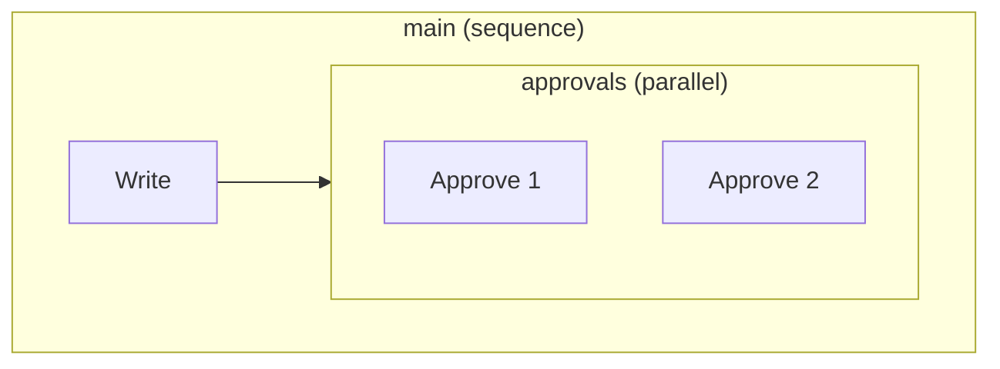

# The workflow suite: block-structured workflows to BPMN to diagrams

The `examples/workflow` suite turns a block-structured workflow
model (a process tree) into a graph-based BPMN process and draws both ends. Its goal is to
show a chain done right: two small metamodels at different levels of
abstraction, transformations whose manifests make them composable
(the first's target metamodel is the second's source), and one
structural translation, tree to graph, as the interesting step.

What the suite contains, and what each piece shows:

- **Two metamodels** (`workflow-metamodel`, `bpmn-metamodel`): the
  block-structured workflow model side, where structure is pure nesting, and the
  graph-based BPMN side, where nodes and flows state everything
  explicitly. The gap between the two is exactly what the chain's
  first step bridges.
- **`workflow-to-mermaid`** (model to text): the
  [structure view](#the-structure-view-the-workflow-model-to-mermaid),
  drawing the SOURCE as a Mermaid flowchart of nested subgraphs, so
  the tree itself is the picture.
- **`workflow-to-bpmn`** (model to model): the flattening. Every
  activity contributes a graph fragment with an entry and an exit
  port, and the composite rules wire their children's ports without
  knowing what is behind them.
- **`bpmn-to-mermaid`** (model to text): the graph drawn. Mermaid has
  no native BPMN notation, so a flowchart with per-kind node shapes
  is the vehicle.
- **The chain**: `workflow-to-bpmn` then `bpmn-to-mermaid` in one
  run, type-checked against the manifests before anything executes.

This page is the canonical explanation of all of it: the metamodels,
the structure view's conventions, the flattening rule by rule, the
graph rendering, and why this suite declares no design space. The
package READMEs stay deliberately short and point here; every rule
described below is enforced by the suite's smoke tests and executable
verification on every merge.

## The metamodels

The suite owns both metamodels, under `examples/workflow/metamodels/`.
They are deliberately small, and this section is all you need to read
the rest of the page.

### The workflow model side

In `workflow-metamodel`, a `Process` owns one body activity, and an
activity is a `Task` (atomic), a `Sequence` (children run in order),
a `Parallel` (children run concurrently), or a `SubProcess` (a named
fragment carrying its own body, implicitly sequential). Structure is
pure nesting: there are no edges to draw and none to get wrong. The
running example, the Approval process
(`workflow-to-bpmn/sample/approval.tsx`):

```tsx
<Process name="Approval" store={store}>
  <Sequence name="main">
    <Task name="Write" />
    <Parallel name="approvals">
      <Task name="Approve 1" />
      <Task name="Approve 2" />
    </Parallel>
  </Sequence>
</Process>
```

### The BPMN side

`bpmn-metamodel` is a simplified graph-based BPMN: a `Process` is
`nodes` (`Task`, `Gateway`, `StartEvent`, `EndEvent`, and
`SubProcess` carrying its own nodes and flows) connected by `Flow`
edges, each with typed `from` and `to` links and an optional `guard`
label, meaningful on flows out of an exclusive gateway. A gateway's
`kind` is parallel or exclusive; whether it splits or joins is
determined by its flows, as in BPMN. What the workflow model guarantees
by nesting, this side states explicitly as edges. Authored directly,
the graph reads like this
(from `bpmn-to-mermaid/sample/approval-bpmn.tsx`):

```tsx
<Task name="Write" />
<Gateway name="split" kind="parallel" />
<Task name="Approve1" />
<Task name="Approve2" />
<Gateway name="join" kind="parallel" />
<Flow name="f2"><FromNode $refByName="Write" /><ToNode $refByName="split" /></Flow>
<Flow name="f3"><FromNode $refByName="split" /><ToNode $refByName="Approve1" /></Flow>
```

## The structure view: the workflow model to Mermaid

Before the flattening, the quickest consumer of the source:
`workflow-to-mermaid` is not a chain step but a sibling view,
model-to-text over the workflow model itself, one Mermaid flowchart per
process. It draws the tree AS a tree: every composite activity
becomes a nested `subgraph` labeled with its kind, so containment,
the fact the source states, is the fact the picture shows. The
rendered Approval below doubles as the picture of the running example
the rest of this page transforms.

The conventions:

- A task is a box: `Approve_1["Approve 1"]`. The id is the authored
  name with every non-alphanumeric character replaced by an
  underscore (names are unique per workflow model, so the sanitized
  name is the id); the label keeps the authored name, spaces
  included.
- A sequence is a subgraph labeled `(sequence)`, and its consecutive
  children are chained with `-->` edges. An edge may start or end at
  a subgraph id, which is how a step points at a whole parallel
  block.
- A parallel is a subgraph labeled `(parallel)` with NO edges between
  its children: side-by-side placement IS the meaning.
- A sub-process is a subgraph labeled `(sub-process)` carrying its
  recursively rendered body; the body is implicitly a sequence, so
  its children chain too.

The transformation's verbatim output for the Approval sample,
rendered by Mermaid itself:



The logic is fixed on purpose: a diagram renderer has no open design
questions at this scale, so the manifest declares no parts and the
CLI runs it without configuration flags:

```bash
synth transformation run workflow-to-mermaid --in demo/approval --out-dir ./diagrams
```

## The transformation, rule by rule

The sections below are the chain's two steps: what each activity kind
BECOMES in the graph, and how the graph becomes a diagram.

### Flattening the tree into a graph

`workflow-to-bpmn` follows a FRAGMENT CONTRACT: every activity
contributes its nodes and flows, plus an entry port and an exit port,
and the rule for a composite activity wires its children's ports
without knowing what is behind them.

- A `Task` becomes one BPMN task; it is its own entry and exit.
- A `Sequence` emits its children's fragments and one flow from each
  child's exit to the next child's entry.
- A `Parallel` wraps its children between a gateway pair
  (`<name>_split`, `<name>_join`): flows from the split to every
  child's entry and from every child's exit to the join.
- A `SubProcess` becomes one BPMN sub-process node whose body is the
  recursively flattened fragment between its own start and end
  events.
- The process itself gains `start` and `end` events wired to its root
  activity's ports.

The dispatch is one pure `@SpecPoint` rule (`activityToGraph`) with
one `@SpecOption` per activity kind, and two helper points
(`toEntryOf`, `fromExitOf`) answer the ports the same way. Flow
elements are named `f1..fn`; all names are unique per model.

### Rendering the graph

`bpmn-to-mermaid` is model-to-text over the graph: one document per
process, a declaration line per node and an edge line per flow.
Mermaid has no BPMN diagram type, so the flowchart carries the
notation with one shape per node kind, chosen by specialization, one
option per kind: tasks render as boxes, gateways as diamonds, events
as stadium shapes, and a sub-process as a nested `subgraph` holding
its own body. A gateway's diamond is labeled with its kind AND its
derived role, `parallel split` or `parallel join`: the role is not
stored in the model (as in BPMN, it is determined by the flows), so
the renderer derives it from the gateway's degrees, more than one
outgoing flow making it a split, more than one incoming a join. A
flow with a `guard` renders its label on the edge.

## No design space, on purpose

None of the three transformations declares a configuration issue: at
this scale every question has one defensible answer, and a design
space with nothing genuinely open in it would be ceremony (the
[full-featured EER to SQL suite](./eer-to-sql.md) is where
configuration-based transformation is shown in earnest). What the
suite adds instead is the composition story: the chain
(`synth transformation run workflow-to-bpmn bpmn-to-mermaid --in demo/approval --out-dir ./generated`)
type-checks against the manifests before anything runs, and the
`templated-approval.tsx` sample builds its block-structured workflow model from a
higher-order template, a template taking the writing step as a
template parameter, resolved in two steps to a model.

## One process, two drawings

The structure view drew the Approval process as a tree above. The
chain's other end is the same process flattened and drawn as a graph:
the chain run in the previous section produces this, verbatim:


The tree states structure by nesting; the graph states the same
structure by gateway pairs and flows. The transformation is exactly
the walk between the two drawings.

## Where the pieces live

- `examples/workflow/metamodels/workflow` and
  `examples/workflow/metamodels/bpmn`: the two metamodel packages,
  each exporting JSX components (bare specifier) and type schemas
  (`/model`).
- `examples/workflow/workflow-to-mermaid`: the structure view, with a
  `release` sample exercising all four activity kinds and a
  verification rendering both approval samples.
- `examples/workflow/workflow-to-bpmn`: the m2m step, with the
  `approval`, `reviewed-approval` (recursion), and
  `templated-approval` (higher-order) samples.
- `examples/workflow/bpmn-to-mermaid`: the m2t step over the graph.
- `design/workflow-suite.md` in the repository records the design.
