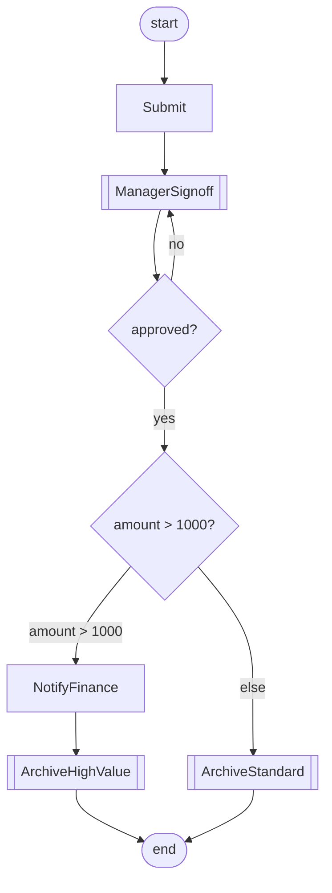
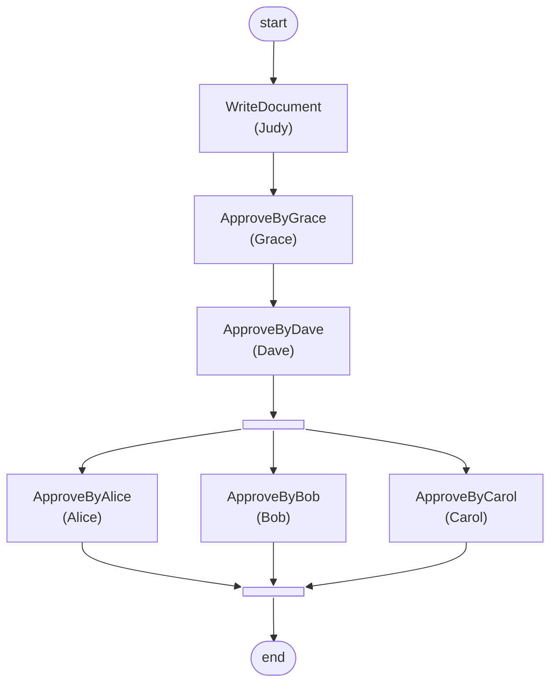
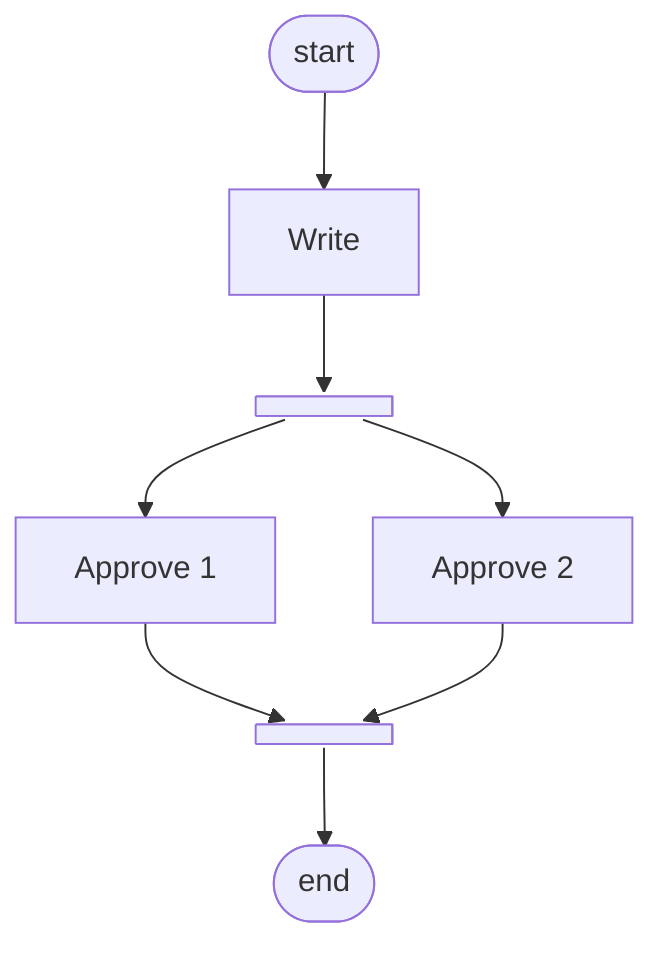
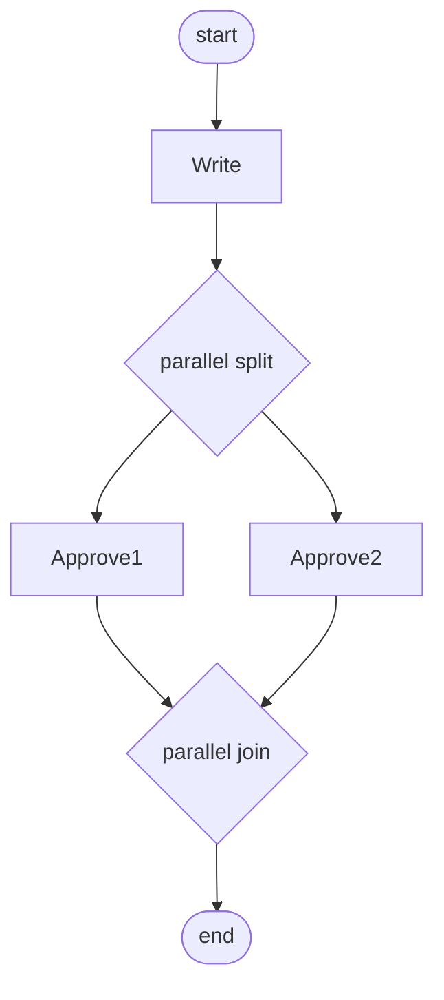

# The workflow suite

The
[`examples/workflow`](https://github.com/AelasticS/Synthesis/tree/main/examples/workflow)
suite turns a block-structured workflow model
(a process tree) into a graph-based BPMN process and draws both ends.
Its goal is to show a chain done right: small metamodels at different
levels of abstraction, transformations whose manifests make them
composable (the first's target metamodel is the second's source), and
one structural translation, tree to graph, as the interesting step.
The suite also owns the generative end of the story: an organizational
model from which an approval process is derived by a parameterized
transformation, feeding the same chain.

What the suite contains, and what each piece shows:

- **Three metamodels**
  ([`workflow-metamodel`](https://github.com/AelasticS/Synthesis/tree/main/examples/workflow/metamodels/workflow),
  [`bpmn-metamodel`](https://github.com/AelasticS/Synthesis/tree/main/examples/workflow/metamodels/bpmn),
  [`org-metamodel`](https://github.com/AelasticS/Synthesis/tree/main/examples/workflow/metamodels/org)):
  the block-structured workflow side, where
  definitions are invoked and structure is pure nesting; the
  graph-based BPMN side, where nodes and flows state everything
  explicitly; and the organizational side, a hierarchy of units and
  workers that the generative example reads. The gap between the first
  two is exactly what the chain's first step bridges.
- **[`org-to-approval`](https://github.com/AelasticS/Synthesis/tree/main/examples/workflow/org-to-approval)**
  (model to model): the generative example. An
  organizational model becomes an approval process, parameterized by
  worker and sensitivity through the engine's parameter channel, with
  the verbatim parameter recorded in the output's provenance.
- **[`workflow-to-mermaid`](https://github.com/AelasticS/Synthesis/tree/main/examples/workflow/workflow-to-mermaid)**
  (model to text): the
  [flowchart view](#the-flowchart-view-the-workflow-model-to-mermaid),
  drawing the SOURCE as a classic flowchart, decision diamonds, fork
  and join bars, and back edges, without flattening it into BPMN
  first.
- **[`workflow-to-bpmn`](https://github.com/AelasticS/Synthesis/tree/main/examples/workflow/workflow-to-bpmn)**
  (model to model): the flattening. Every step
  contributes a graph fragment with an entry and an exit, and the
  composite rules wire their children's fragments without knowing what
  is behind them.
- **[`bpmn-to-mermaid`](https://github.com/AelasticS/Synthesis/tree/main/examples/workflow/bpmn-to-mermaid)**
  (model to text): the graph drawn. Mermaid has
  no native BPMN notation, so a flowchart with per-kind node shapes
  is the vehicle.
- **The chain**: `workflow-to-bpmn` then `bpmn-to-mermaid` in one
  run, type-checked against the manifests before anything executes,
  and extended to three steps when `org-to-approval` leads it.

This page is the canonical explanation of all of it: the metamodels,
the flowchart view's conventions, the flattening rule by rule, the
graph rendering, the organizational example, and why this suite
declares no design space. The package READMEs stay deliberately short
and point here; every rule described below is enforced by the suite's
smoke tests and executable verification on every merge.

## The metamodels

The suite owns all three metamodels, under
[`examples/workflow/metamodels/`](https://github.com/AelasticS/Synthesis/tree/main/examples/workflow/metamodels).
They are deliberately small, and this
section is all you need to read the rest of the page.

### The workflow model side

[`workflow-metamodel`](https://github.com/AelasticS/Synthesis/tree/main/examples/workflow/metamodels/workflow)
rests on one distinction: **a definition is not
an occurrence**. If the same signoff round runs twice in a process,
there is one activity defined and two places that call it; collapsing
the two ideas would force either copy-paste or a graph of shared
nodes. BPMN and UML draw the same line (a BPMN process or global task
is called by a call activity; a UML activity is called by a call
behavior action), and the metamodel keeps it explicit:

- A `WorkflowModel` is the model root. At model level it carries the
  vocabulary: `DocumentType`s and activity definitions.
- An `Activity` definition is a `Task` (simple) or a `Process`
  (complex, carrying `steps`). Every definition declares an optional
  `performer` and its document interface: `inputs` and `outputs` as
  DocumentType references.
- A process body is a list of `Step`s, and a body invokes definitions
  through `Invocation` steps: the `activity` link names what is
  called, and the optional occurrence name defaults to the
  definition's. `<Invoke>` is the general invocation tag, and
  `<SubProcess $refByName="X" />` is its process-call sugar over the
  same concept.
- Inline authoring stays as single-use sugar: an `Activity` IS a
  `Step`, so a Task or Process written directly in a body is an
  anonymous single-use definition fused with its sole occurrence,
  which is exactly BPMN's embedded sub-process. An invocation of a
  named definition corresponds to BPMN's call activity instead.

The same split organizes data, as types versus instances. A
`DocumentType` is model-level vocabulary (BPMN's ItemDefinition); a
definition's `inputs`/`outputs` declare the types it works over (the
interface, BPMN's ioSpecification); a `Document` is a process-level
concrete carrier typed by a DocumentType (BPMN's DataObject); and an
INVOCATION binds the enclosing process's documents through `reads` and
`writes`. Conformance is a declared constraint, not machinery: a bound
document's type must be among the called definition's declared types,
judged by `synth model validate`.

Control flow completes the operators. A `Sequence` runs its children
in order and a `Parallel` runs them concurrently. A `Choice` holds
`Branch`es: each branch may carry a `guard`, and a guardless branch is
the else (declared constraints require at least one branch and admit
at most one guardless one). One `Loop` concept covers both classical
forms through its `kind`: `while` tests the `guard` before the body,
`repeatUntil` runs the body before the test. With sequence, parallel,
choice, and loop the model covers the classical structured
control-flow patterns: control-flow complete for structured processes.

Two conventions keep the authoring light. **Implicit sequences**: a
process body, a branch body, and a loop body are sequences already, so
`<Sequence>` is needed only to group steps inside another operator.
And a `Process` is a **name scope**: inline names and occurrence names
are unique per process, not per model, so two processes can both have
a `Sign` step.

The simplest model in the suite, the Approval process
(`workflow-to-bpmn/sample/approval.tsx`), is one inline process whose
body is an implicit sequence:

```tsx
<WorkflowModel name="Approval" store={store}>
  <Process name="Approval">
    <Task name="Write" />
    <Parallel name="approvals">
      <Task name="Approve 1" />
      <Task name="Approve 2" />
    </Parallel>
  </Process>
</WorkflowModel>
```

The richer sample (`workflow-to-bpmn/sample/expense-approval.tsx`)
exercises everything above in one model: a document type, a task
definition invoked twice under different occurrence names, a process
definition called through the `<SubProcess>` sugar inside a
repeat-until loop, a guarded choice with an else, and a report
document bound through reads and writes:

```tsx
<WorkflowModel name="ExpenseApproval" store={store}>
  <DocumentType name="ExpenseReport" />
  <Task name="Archive" performer="Clerk"
        inputs={[<DocumentType $refByName="ExpenseReport" />]} />
  <Process name="ManagerSignoff" performer="Manager"
           inputs={[<DocumentType $refByName="ExpenseReport" />]}
           outputs={[<DocumentType $refByName="ExpenseReport" />]}>
    <Task name="CheckBudget" />
    <Task name="Sign" />
  </Process>
  <Process name="HandleExpense">
    <Document name="report" documentType={<DocumentType $refByName="ExpenseReport" />} />
    <Task name="Submit" />
    <Loop kind="repeatUntil" guard="approved">
      <SubProcess $refByName="ManagerSignoff"
                  reads={[<Document $refByName="report" />]}
                  writes={[<Document $refByName="report" />]} />
    </Loop>
    <Choice>
      <Branch guard="amount > 1000">
        <Task name="NotifyFinance" />
        <Invoke name="ArchiveHighValue" activity={<Task $refByName="Archive" />}
                reads={[<Document $refByName="report" />]} />
      </Branch>
      <Branch>
        <Invoke name="ArchiveStandard" activity={<Task $refByName="Archive" />}
                reads={[<Document $refByName="report" />]} />
      </Branch>
    </Choice>
  </Process>
</WorkflowModel>
```

The metamodel's doctrine is declared as constraints and judged at the
validation point, never at authoring time (a model being built is
legitimately incomplete): an invocation names the definition it calls,
read and written documents conform to the called definition's declared
inputs and outputs, a choice offers at least one branch and at most
one guardless one, a loop states its guard, and a document is typed.
`synth model import` admits what renders; `synth model validate` runs
the constraints and reports each violation with the rule's own
message.

### The BPMN side

[`bpmn-metamodel`](https://github.com/AelasticS/Synthesis/tree/main/examples/workflow/metamodels/bpmn)
is a simplified graph-based BPMN: a `Process` is
`nodes` (`Task`, `Gateway`, `StartEvent`, `EndEvent`, and
`SubProcess` carrying its own nodes and flows) connected by `Flow`
edges, each with typed `from` and `to` links and an optional `guard`
label, meaningful on flows out of an exclusive gateway. A gateway's
`kind` is parallel or exclusive; whether it splits or joins is
determined by its flows, as in BPMN. What the workflow model
guarantees by nesting, this side states explicitly as edges. Authored
directly, the graph reads like this
(from `bpmn-to-mermaid/sample/approval-bpmn.tsx`):

```tsx
<Task name="Write" />
<Gateway name="split" kind="parallel" />
<Task name="Approve1" />
<Task name="Approve2" />
<Gateway name="join" kind="parallel" />
<Flow name="f2"><FromNode $refByName="Write" /><ToNode $refByName="split" /></Flow>
<Flow name="f3"><FromNode $refByName="split" /><ToNode $refByName="Approve1" /></Flow>
```

### The organizational side

[`org-metamodel`](https://github.com/AelasticS/Synthesis/tree/main/examples/workflow/metamodels/org)
is the generative example's source domain. An
`Organization` names its top unit, and `OrgUnit`s form the hierarchy
through the parent/subUnits inverse: a unit nests in its parent or
names it as a reference prop, and `subUnits` fills itself. `Worker`s
are members of the unit they work in (the worksIn/members inverse). A
`Department` is a unit run by a manager, and a `Board` is a unit
governed by its members collectively, which is why it declares no
manager. The `manager` link is type-level optional under the
creation-order regime, because the manager is one of the department's
own members and so exists only after the workers do; the declared
constraint requires it, as another requires the organization's top
unit, and `synth model validate` judges both.

## The flowchart view: the workflow model to Mermaid

Before the flattening, the quickest consumer of the source:
[`workflow-to-mermaid`](https://github.com/AelasticS/Synthesis/tree/main/examples/workflow/workflow-to-mermaid)
is not a chain step but a sibling view,
model-to-text over the workflow model itself. It draws the model's
ENTRY PROCESS (the first process definition no invocation calls, the
root of the call graph) as one classic flowchart. The walk is a
wiring contract: every step yields an entry node and a LIST of exit
nodes, a sequence connects all previous exits to the next step's
entry, a start stadium opens the chart wired to the first step's
entry, and every final exit wires to the end stadium.

The conventions:

- A task is a box: `Submit["Submit"]`. The id is the authored name
  with every non-alphanumeric character replaced by an underscore
  (names are unique per process scope, so the sanitized name is the
  id); the label keeps the authored name, spaces included. A
  performer becomes a parenthesized second label line:
  `Write["Write<br/>(Judy)"]`.
- An invocation is a subroutine box named by the occurrence
  (defaulting to the called definition's name):
  `ManagerSignoff[["ManagerSignoff"]]`. Call semantics stays opaque:
  what the called definition does stays behind the call. An INLINE
  process step, being single-use grouping, expands inline into its
  steps instead; its own name does not appear in the drawing.
- A choice is ONE decision diamond. The diamond asks the authored
  choice name as its question; an unnamed choice with exactly one
  guarded branch asks that guard, and any other unnamed choice asks a
  bare `?`. Each branch's outgoing edge is labeled with its guard,
  the guardless branch's edge with `else`, and ALL branch exits
  become the choice's exits: the branches reconverge on whatever
  comes next, with no merge node.
- A loop is a guard diamond labeled `<guard>?` and a back edge. A
  repeatUntil runs the body first and tests after it: the `no` edge
  returns to the body's entry, the `yes` edge is the exit. A while
  tests first: the `yes` edge enters the body, whose exits return to
  the diamond unlabeled, and the `no` edge is the exit.
- A parallel is a fork bar (`approvals_fork@{ shape: fork }`) fanning
  out to every child's entry and a join bar every child's exits
  converge on; the join is the exit.
- An unnamed operator gets a generated per-kind id (`choice1`,
  `loop1`).
- Documents are not drawn.

The transformation's verbatim output for the ExpenseApproval sample,
rendered by Mermaid itself:



The `ManagerSignoff` subroutine box is the invocation, not the
definition: the called process's own two tasks are not drawn here,
because the flowchart view draws the calling process. The two archive
boxes are two occurrences of the ONE `Archive` definition, each under
its own occurrence name, and both wire straight to the end stadium:
the choice's branches reconverge without a merge node.

The logic is fixed on purpose: a diagram renderer has no open design
questions at this scale, so the manifest declares no parts and the
CLI runs it without configuration flags:

```bash
synth transformation run workflow-to-mermaid --in demo/expense --out-dir ./diagrams
```

## The transformation, rule by rule

The sections below are the chain's two steps: what each step kind
BECOMES in the graph, and how the graph becomes a diagram.

### Flattening the tree into a graph

[`workflow-to-bpmn`](https://github.com/AelasticS/Synthesis/tree/main/examples/workflow/workflow-to-bpmn)
follows a FRAGMENT CONTRACT: every step contributes
its nodes and flows, plus an entry and an exit, and the rule for a
composite step wires its children's fragments without knowing what is
behind them. The dispatch is one pure `@SpecPoint` rule
(`stepToGraph`) with one `@SpecOption` per step kind, and two helper
points (`toEntryOf`, `fromExitOf`) answer the boundaries the same
way. Flow elements are named `f1..fn`.

- The transformation flattens the model's **entry process**: the first
  process definition no invocation in the model calls. The process
  gains `start` and `end` events wired to its body's boundaries.
- A `Task` becomes one BPMN task; it is its own entry and exit.
- A `Sequence` emits its children's fragments and one flow from each
  child's exit to the next child's entry, and every implicit sequence
  (a process body, a branch body, a loop body) chains the same way.
- A `Parallel` wraps its children between a parallel gateway pair
  (`<base>_split`, `<base>_join`): flows from the split to every
  child's entry and from every child's exit to the join. The base is
  the step's authored name, or a generated per-kind one (`par1`,
  `choice1`, `loop1`) for unnamed steps.
- A `Choice` becomes an exclusive gateway pair: the split's outgoing
  flow into each branch carries that branch's `guard`, the else flow
  stays unguarded, and every branch converges on the join.
- A `Loop` becomes a gateway pair around its body: a converging entry
  (`<base>_entry`) merges the incoming flow with the loop's return,
  and a diverging exit (`<base>_exit`) is the test. The `kind` places
  the test. A `while` tests before the body: the entry flows straight
  to the exit, and the exit's guarded flow enters the body. A
  `repeatUntil` tests after it: the body runs from the entry to the
  exit, and the guarded back edge returns to the entry labeled
  `not <guard>`, honestly, because the loop runs again only while the
  guard has not yet come true.
- An `Invocation` of a task becomes a task named by the occurrence,
  which is how one definition invoked twice yields two distinct nodes.
- An `Invocation` of a process, and an inline process step, expand as
  an embedded BPMN sub-process named by the occurrence, its body
  recursively flattened between its own start and end events. Every
  inner name carries the sub-process's name as a prefix
  (`ManagerSignoff_Sign`), because the BPMN model is one flat name
  scope per container while workflow names are unique only per
  process, and one definition may expand under several occurrences.

Stage A of the suite deliberately does NOT flatten documents or
performers: the graph carries control flow only. A process invocation
expands as an embedded sub-process rather than a call, too. The BPMN
side's growth to the standard's Descriptive conformance subclass
(call activities for invocations, data objects for documents, lanes
fed by performers) is the suite's recorded next stage, in
`design/workflow-suite-v2.md`.

### Rendering the graph

[`bpmn-to-mermaid`](https://github.com/AelasticS/Synthesis/tree/main/examples/workflow/bpmn-to-mermaid)
is model-to-text over the graph: one document per
process, a declaration line per node and an edge line per flow.
Mermaid has no BPMN diagram type, so the flowchart carries the
notation with one shape per node kind, chosen by specialization, one
option per kind: tasks render as boxes, gateways as diamonds, events
as stadium shapes, and a sub-process as a nested `subgraph` holding
its own body. A gateway's diamond is labeled with its kind AND its
derived role, `parallel split` or `exclusive join`: the role is not
stored in the model (as in BPMN, it is determined by the flows), so
the renderer derives it from the gateway's degrees, more than one
outgoing flow making it a split, more than one incoming a join. A
flow with a `guard` renders its label on the edge
(`-->|amount > 1000|`), which is how the choice's guarded flows and
the loop's back edge reach the drawing.

## The organizational example: a model generates a process

[`org-to-approval`](https://github.com/AelasticS/Synthesis/tree/main/examples/workflow/org-to-approval)
closes the loop the suite opens: instead of a
process authored by hand, a process DERIVED from a domain model. The
paper's example, executable: who must approve a worker's document is
not workflow knowledge, it is organizational knowledge, so the
transformation reads the organizational hierarchy upward and emits the
approval process that hierarchy implies.

The source is the AcmeCorp organization
(`org-to-approval/sample/acme.tsx`): an executive board over two
nested departments, laid flat with reference props, each department
naming its manager among its own members after they exist:

```tsx
<Organization name="AcmeCorp" store={store}>
  <Board name="Executive Board">
    <Worker name="Alice" />
    <Worker name="Bob" />
    <Worker name="Carol" />
  </Board>
  <Department name="Technology Division" parent={<OrgUnit $refByName="Executive Board" />}>
    <Worker name="Dave" role="manager" />
    <Manager $refByName="Dave" />
  </Department>
  <Department name="Engineering" parent={<OrgUnit $refByName="Technology Division" />}>
    <Worker name="Grace" role="manager" />
    <Worker name="Judy" role="engineer" />
    <Manager $refByName="Grace" />
  </Department>
  <TopUnit $refByName="Executive Board" />
</Organization>
```

The run is parameterized through the engine's parameter channel,
`transform(source, param)`, which the CLI carries as `--param <json>`
(bound to step 1 of a chain, like `--config`):

```bash
synth transformation run org-to-approval --in demo/acme --out demo/approval2 \
  --param '{"worker":"Judy","sensitivity":2}'
```

The `worker` names whose document needs approval, resolved by name
inside the transformation because a CLI parameter is JSON and cannot
carry an element reference (an unknown name answers by listing the
workers the organization knows). The `sensitivity` is the unfold
depth: the worker's unit chain is walked upward that many levels, and
each unit contributes one approval step by kind, through a
`@SpecPoint`/`@SpecOption` pair per unit kind: a department the
approval task of its manager, a board a parallel block of its members'
approval tasks, because a board approves collectively.

Reproducibility is the provenance's job. The verbatim parameter JSON
is recorded as `generatedBy.param` in the header of every artifact the
run writes, output models and persisted traces alike, so the envelope
remembers what produced the model without polluting the model itself.
The generated model's header, verbatim:

```tsx
generatedBy: {
  tx: 'org-to-approval',
  txVersion: '0.1.0',
  config: 'defaults',
  param: '{"worker":"Judy","sensitivity":2}',
  date: '2026-09-07T16:13:09.217Z'
},
```

Sensitivity decides how much of the hierarchy approves. At
sensitivity 2, Judy's chain reaches her department's manager and its
parent's, and the generated process body is three tasks in an implicit
sequence:

```tsx
<Process name="ApprovalForJudy">
  <Task name="WriteDocument" performer="Judy" />
  <Task name="ApproveByGrace" performer="Grace" />
  <Task name="ApproveByDave" performer="Dave" />
</Process>
```

At sensitivity 3 the chain reaches the executive board, and the
board's collective approval appears as a parallel block:

```tsx
<Process name="ApprovalForJudy">
  <Task name="WriteDocument" performer="Judy" />
  <Task name="ApproveByGrace" performer="Grace" />
  <Task name="ApproveByDave" performer="Dave" />
  <Parallel name="Executive Board approvals">
    <Task name="ApproveByAlice" performer="Alice" />
    <Task name="ApproveByBob" performer="Bob" />
    <Task name="ApproveByCarol" performer="Carol" />
  </Parallel>
</Process>
```

The generated model is an ordinary workflow model, so everything on
this page applies to it: the chain continues onward in one run
(`org-to-approval workflow-to-bpmn bpmn-to-mermaid`), and the
flowchart view draws the persisted result, every performer on its
task's box. Its verbatim drawing of the sensitivity-3 process,
rendered by Mermaid itself:



The verification (`org-to-approval/scripts/verify.mjs`) runs both
sensitivities, the parameter's error paths, the onward chain, and this
flowchart view through the real CLI on every gate run.

## No design space, on purpose

None of the workflow transformations declares a configuration issue:
at this scale every question has one defensible answer, and a design
space with nothing genuinely open in it would be ceremony.
`org-to-approval` is parameterized, but a parameter is not a
configuration: `{worker, sensitivity}` is the run's INPUT, data that
picks which process to derive, not a recorded closure of open design
decisions (the [full-featured EER to SQL suite](./eer-to-sql.md) is
where configuration-based transformation is shown in earnest). What
the suite adds instead is the composition story: the chain
(`synth transformation run workflow-to-bpmn bpmn-to-mermaid --in demo/approval --out-dir ./generated`)
type-checks against the manifests before anything runs, and the
`templated-approval.tsx` sample builds its block-structured workflow
model from a higher-order template, a template taking the writing step
as a template parameter, resolved in two steps to a model.

## One process, two drawings

The same Approval process, drawn from both ends of the chain. The
flowchart view draws the source, verbatim:



The chain's other end is the same process flattened and drawn as a
graph, verbatim:



The two drawings share the medium but speak different notations. The
flowchart view speaks the classic idiom: a decision is one diamond
asking its guard as a question, its branches reconverge invisibly on
whatever comes next, a loop closes with a bare back edge, and
concurrency is a pair of fork and join bars. The BPMN graph states
every one of those joints as an explicit node: a gateway pair per
operator, the split AND the join drawn as diamonds labeled with their
derived roles, bracketed by start and end events. The transformation
is exactly the walk between the two notations.

## Where the pieces live

- [`examples/workflow/metamodels/workflow`](https://github.com/AelasticS/Synthesis/tree/main/examples/workflow/metamodels/workflow),
  [`examples/workflow/metamodels/bpmn`](https://github.com/AelasticS/Synthesis/tree/main/examples/workflow/metamodels/bpmn),
  and
  [`examples/workflow/metamodels/org`](https://github.com/AelasticS/Synthesis/tree/main/examples/workflow/metamodels/org):
  the three metamodel packages,
  each exporting JSX components (bare specifier) and type schemas
  (`/model`).
- [`examples/workflow/workflow-to-mermaid`](https://github.com/AelasticS/Synthesis/tree/main/examples/workflow/workflow-to-mermaid):
  the flowchart view, with a
  `release` sample and a verification rendering three samples and
  exercising the declared constraints through `synth model validate`.
- [`examples/workflow/workflow-to-bpmn`](https://github.com/AelasticS/Synthesis/tree/main/examples/workflow/workflow-to-bpmn):
  the m2m step, with the
  `approval`, `reviewed-approval` (an inline process),
  `expense-approval` (choice, loop, invocations, documents), and
  `templated-approval` (higher-order) samples.
- [`examples/workflow/bpmn-to-mermaid`](https://github.com/AelasticS/Synthesis/tree/main/examples/workflow/bpmn-to-mermaid):
  the m2t step over the graph,
  whose verification asserts the flattened v2 shape.
- [`examples/workflow/org-to-approval`](https://github.com/AelasticS/Synthesis/tree/main/examples/workflow/org-to-approval):
  the generative example, with
  the `acme` sample.
- `design/workflow-suite-v2.md` in the repository records the design.
