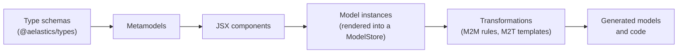

# Synthesis Transformation Language

Synthesis is a language for model-driven development, implemented as an
embedded domain-specific language within TypeScript. You define metamodels as
type schemas, construct model instances using JSX syntax, and write
model-to-model transformations as TypeScript classes with JSX templates.

This guide is for **transformation authors**: developers who build
metamodels, models, and transformations. If you only want to *run*
transformations that others have published, the [User Guide](../user-guide/index.md)
covers the `synth` CLI from installation to pipelines.

## What You Can Build

- **Metamodels** that describe the structure of a domain (entities, properties, associations, subtype hierarchies).
- **Model instances** assembled declaratively with JSX. Nesting captures associations. Embedded TypeScript expressions (map, conditionals, function calls) generate structure dynamically.
- **Parameterized templates** that produce families of structurally different models from a single definition.
- **Model-to-model transformations** that map source models to target models with typed rules and automatic tracing.
- **Configurable transformations** with variability points that select different strategies at runtime based on a decision model.

## How the Pieces Fit



- A **metamodel** is a set of runtime type schemas defined with
  [`@aelastics/types`](../types/intro.md), the same library usable standalone
  for schema definition and validation.
- **JSX components** are thin wrappers that map those types to JSX tags, so
  models can be written as declarative expressions.
- Model instances live in a **ModelStore**, whose reactive identity and
  runtime type conformance come from [`@aelastics/store`](../store/intro.md).
- **Transformations** are classes whose rules map source elements to target
  JSX; the engine executes them with automatic tracing, reporting failures
  through [`@aelastics/result`](../result/intro.md).
- Ready-made metamodels (EER and Relational, in tutorial and full-size
  variants) ship as packages owned by the
  [example suites](./examples/index.md), and the
  [`synth` CLI](../user-guide/index.md) runs, packages, and distributes the result.

## Developer Workflow

A typical project follows these steps:

```text
1. Define metamodels          (type schemas using @aelastics/types)
2. Create JSX components      (thin wrappers that map types to JSX tags)
3. Build model instances      (JSX expressions rendered via ModelStore)
4. Write transformations      (classes extending abstractM2M with @E2E rules)
5. Execute and use results    (call transform(), get typed target model)
```

## Running Example

The documentation uses an **EER-to-Relational** transformation as the running example throughout all pages. An Extended Entity-Relationship metamodel (with Entities, Attributes, Domains, and subtype distinctions like Kernel vs Weak) is transformed into a Relational metamodel (Tables, Columns, Indexes, ForeignKeys).

A secondary example uses **block-structured workflow models** (a process tree of Process, Task, Sequence, and Parallel steps) to illustrate parameterized and higher-order templates.

## Sharing Your Work

A transformation is more than code: it can be packaged as an installable npm package with a `synth.json` manifest describing its source and target metamodels and any variability points. See [Packaging Transformations](./guides/packaging-transformations.md).
