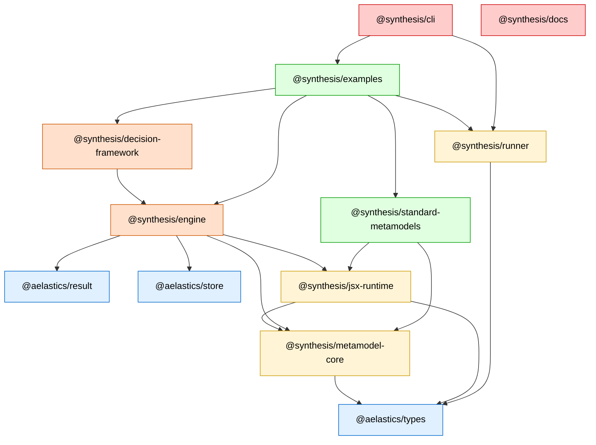

# Monorepo Architecture

> Internal architecture documentation for contributors to Synthesis itself.
> User and developer documentation lives on the
> [documentation site](https://AelasticS.github.io/aelastics/).

Synthesis is organized as a 12-package monorepo with a strict, acyclic dependency graph. Packages are layered from generic infrastructure at the bottom to applications at the top.

## Packages by Layer

**Layer 0: Generic infra** (no Synthesis-specific knowledge)

- `@aelastics/types`
- `@aelastics/result`
- `@aelastics/store`

**Layer 1: Synthesis foundations**

- `@synthesis/metamodel-core`: depends on `@aelastics/types`
- `@synthesis/jsx-runtime`: depends on `@aelastics/types`, `@synthesis/metamodel-core`

**Layer 2: Runtime + utility packages**

- `@synthesis/engine`: depends on `@synthesis/metamodel-core`, `@synthesis/jsx-runtime`, `@aelastics/result`, `@aelastics/store`
- `@synthesis/runner`: depends on `@aelastics/types`

**Layer 3: Decision-driven extension**

- `@synthesis/decision-framework`: depends on `@synthesis/engine`

**Layer 4: Applications**

- `@synthesis/standard-metamodels`: depends on `@synthesis/metamodel-core`, `@synthesis/jsx-runtime`
- `@synthesis/examples`: depends on `@synthesis/engine`, `@synthesis/decision-framework`, `@synthesis/standard-metamodels`, `@synthesis/runner`
- `@synthesis/cli`: depends on `@synthesis/examples`, `@synthesis/runner`
- `@synthesis/docs`: independent (typedoc site, not in build graph)

## Dependency Graph



An arrow `A → B` means *A depends on B*: A imports from B.

## Rules

- No cycles. Arrows always go from higher layers down.
- `@synthesis/metamodel-core` contains only type schemas. The foundational JSX wrappers (`Element`, `Model`) for those types live in `@synthesis/jsx-runtime` alongside the JSX primitives, because `jsx-runtime` already imports the foundational types; adding a `metamodel-core/jsx` subpath would introduce a workspace-level package cycle that Rush cannot resolve.
- `@synthesis/standard-metamodels` does NOT depend on `@synthesis/engine`; it depends only on `metamodel-core` and `jsx-runtime`.
- `@synthesis/jsx-runtime` is the boundary between "data shape" (in `metamodel-core`) and "M2M transformation" (in `engine`). It carries enough engine-decoupling abstractions (`IM2MContext`, `IStore`) that `engine` is the *only* package that knows about the M2M runtime itself.

## Layer 0: Generic infra

Three `@aelastics/*` packages with no Synthesis-specific knowledge. `@aelastics/result` provides a `Result` monad for error-typed returns. `@aelastics/types` is a runtime type schema framework. `@aelastics/store` is an observable store. Any future product under the Aelastics organization could reuse them as-is.

## Layer 1: Synthesis foundations

`@synthesis/metamodel-core` defines the M3-level type schemas (`Model`, `ModelElement`, `Namespace`, `Diagram`, `RepositoryObject`, plus basic types like `IDType`, `NameType`, `DescriptionType`). It contains pure `@aelastics/types` schema values and no JSX.

`@synthesis/jsx-runtime` builds on top of `metamodel-core`. It provides the JSX authoring primitives (`ExprNode`, `Template`, `CpxTemplate`, `Context`, the `IM2MContext` and `IStore` interfaces, URL/path parsing), plus the foundational JSX wrappers (`Element`, `Model`) for `metamodel-core`'s most-used types. Keeping the JSX runtime here, not bundled inside the engine, is what lets `@synthesis/standard-metamodels` and other downstream packages author JSX content without pulling in the full M2M engine.

## Layer 2: Runtime + utility packages

`@synthesis/engine` is the M2M transformation runtime: the `abstractM2M` base class, decorators (`@E2E`, `@SpecPoint`, `@SpecOption`), the pure trace metamodel, `ModelStore`, `M2MContext` (which implements `IM2MContext` from `jsx-runtime`), the `m2t` text-generation tool, and the `jsx-export` snapshot tool. The engine is decision-agnostic; it knows nothing about decisions, configurations, or variability.

`@synthesis/runner` defines the minimal execution contract (`Runnable` + `RunnableRegistry`) that consumers of the engine implement. It has no engine dependency, so it can be reused outside the engine context.

## Layer 3: Decision-driven extension

`@synthesis/decision-framework` is the optional decision-aware layer built on top of the engine: decision / binding / configuration / trace-extension metamodels, the `DecisionAwareM2M` subclass of `abstractM2M`, and the variability decorators (`@VarPoint`, `@VarOption`, `@Default`).

## Layer 4: Applications

Four user-facing packages. `@synthesis/standard-metamodels` ships canonical domain metamodels (EER, Relational, BPM, types-metamodel); it depends only on `metamodel-core` + `jsx-runtime`, never on the engine, which keeps it usable in arbitrary contexts. `@synthesis/examples` provides demonstrations as `Runnable` instances. `@synthesis/cli` is the user entry point; it discovers and runs examples via the Runner contract. `@synthesis/docs` is the Docusaurus documentation site, independent of the build graph.

## Where the foundational JSX wrappers live

The JSX wrappers (`Element`, `Model`) for `metamodel-core`'s foundational types live in `@synthesis/jsx-runtime`, **not** in `metamodel-core`. Consumers import the schema and the wrapper from different packages:

```ts
import { Model, ModelElement } from '@synthesis/metamodel-core';
import { Element, Model as ModelComponent } from '@synthesis/jsx-runtime';
```

The original design instinct was to co-locate the wrappers next to their type schemas as a `metamodel-core/jsx` subpath. That turns out not to be possible at the workspace level: `jsx-runtime` already depends on `metamodel-core` (its wrappers and `ExprNode` reference `IModelElement` / `IModel`), so making `metamodel-core` depend on `jsx-runtime` for its subpath would form a cycle that Rush rejects. Putting the wrappers in `jsx-runtime` instead, where they are conceptually JSX primitives, keeps the dependency graph acyclic with no loss of semantic clarity. Domain-specific JSX components (BPM `<Process>`, EER `<Kernel>`, etc.) remain co-located with their type definitions inside `@synthesis/standard-metamodels`, because those packages depend on `jsx-runtime` rather than being depended on by it.

## Why this structure?

A layered, acyclic dependency graph keeps each package's responsibility narrow and its API surface explicit. Lower layers ship without knowing about higher ones, so they can be reused, versioned, and tested in isolation. Optional capabilities (decisions, variability) live in separate layers that consumers opt into by adding a dependency. Forbidding cycles means there is always a clear bottom-up build order and no hidden coupling between siblings.
